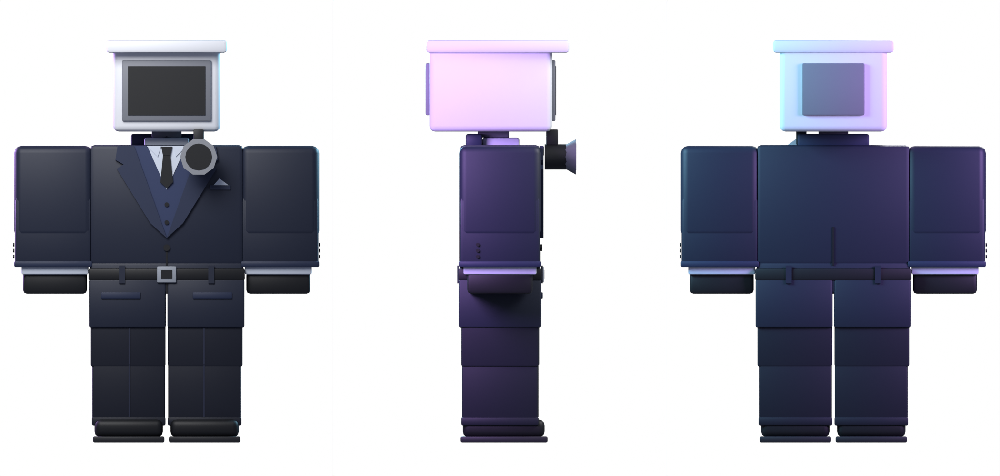

# Cameraman — R15 test model

A blocky Cameraman built on the R15 rig in `source/RobloxR15Rigged.obj`: a CCTV
camera head with a hanging lens and a fully modelled three-piece suit (lapels,
vest, shirt, tie, pocket square, belt, coat skirt, cuffs, gloves and shoes).



## Files

| File | Use |
| --- | --- |
| `export/Cameraman_R15.fbx` | Rigged model for Roblox's 3D Importer / Avatar Importer (16 bones, one mesh per R15 part, rigid weights, texture embedded) |
| `export/Cameraman_R15.blend` | Blender 5.1 source: armature + parts, with the original rig in a hidden `R15_Reference` collection |
| `export/Cameraman_R15.obj` | Static parts at the original rig's scale (100 units/stud), one object per R15 part |
| `export/cameraman_palette.png` | The single 256×256 color-swatch texture every part uses |
| `build_cameraman.py` | Script that generates everything above |

Every part is named exactly after its R15 part/bone (`Head`, `UpperTorso`,
`LeftUpperArm`, …) and fits inside that part's bounds on the reference rig.
`HumanoidRootPart` is an invisible 2×2×1 box. The scene uses Roblox's Blender
settings (unit scale 0.01, FBX Units Scale), so 1 Blender unit = 1 stud and the
character is about 5.4 studs tall.

## Rebuild

```sh
python -m venv venv && venv/bin/pip install bpy==5.1.2
venv/bin/python build_cameraman.py        # add --no-render to skip previews
```
